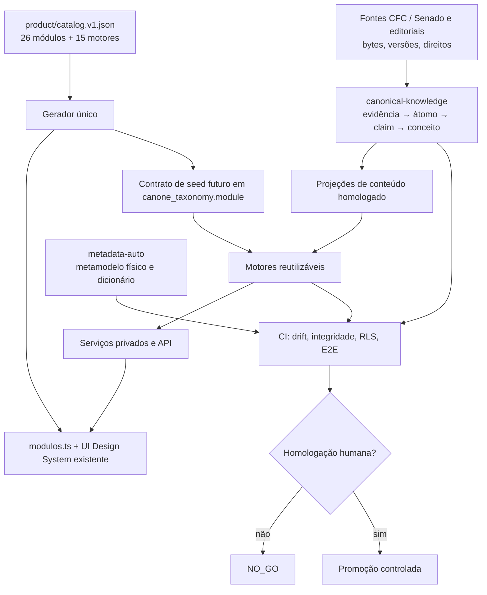

# ADR 0008 — Uma autoridade de produto, motores reutilizáveis e projeções geradas

**Estado:** ACCEPTED_FOR_DEVELOPMENT — release comercial `NO_GO`; **data:** 14/11/2026.

## Contexto

O Cânone S5 possui um catálogo de 26 módulos em `app/src/content/modulos.ts`; o banco original modela `taxonomy.module`, mas suas migrations 001–030 ainda não foram aplicadas ao host compartilhado. Uma segunda lista editada manualmente no banco, na interface ou em um agente resultaria em drifts. Ao mesmo tempo, o Cânone já possui um Design System, um gerador de contrato do Comander, geradores `metadata-auto` e `canonical-knowledge`: nenhum deles deve ser substituído.

## Decisão

1. **Autoridade declarativa única de produto, temporária até a homologação operacional:** `backend/contracts/product/catalog.v1.json`. Mantém nomes/IDs/ordem dos 26 módulos, fases, ondas e IDs dos motores. Não contém conteúdos normativos, preços, gabaritos ou permissões de usuário.
2. **Projeção gerada do catálogo:** `app/src/content/modulos.ts`. O código UI continua a usar `MODULOS`, `FASES`, `porFase` e `moduloPorId`, mas não deve ser editado manualmente. O gerador rejeita alteração fora da fonte `catalog.v1.json`.
3. **Motor único por capacidade:** o registro `engines` lista 15 responsáveis de capacidade. Os 26 módulos apenas compõem seus contratos; um módulo NÃO implementa uma cópia própria de lógica de notas, sessão, autoria normativa, SRS, metamodelo ou cálculo.
4. **Design System único já existente:** `app/src/brand/tokens.css`, `base.css`, `primitives.css`, `layout.css`, `app/src/ui/primitives.tsx` e `app/src/ui/Nav.tsx`. Proibido criar biblioteca concorrente de botões, cartões, paletas, ícones e tipografia; evoluir os arquivos existentes com testes de acessibilidade.
5. **Modelo de dados:** `canone_taxonomy.module` será a projeção relacional operacional dos IDs do catálogo **somente após** portar e homologar as migrations em PostgreSQL isolado de teste. O banco S5 atual contém namespaces e quatro tabelas de controle, não as entidades operacionais. Planejar um mecanismo de reconcilição bidirecional com `UNKNOWN_ID`/`DRIFT` bloqueantes e mudanças de produto versionadas. Antes disso, o catálogo JSON é a autoridade de desenvolvimento e o frontend é uma projeção estática.
6. **Conhecimento contábil separado do catálogo de produto:** `backend/integrations/canonical-knowledge/` continua sendo a autoridade semântica de fonte preservada → trecho → átomo → claim → conceito → projeção. `metadata-auto` continua como autor do inventário físico de PK/FK/tipos. Nenhum desses pacotes será recriado no registro de produto.
7. **Contrato de aceite único:** `feature-template.v1.json`, gerando 7 critérios por módulo (182 microtarefas), todos `PENDING`. O gate de produção permanece `HOLD_HUMAN_NO_GO`.
8. **Preservação de identidade:** manter `reposicao` e `videodulas` como IDs históricos. Qualquer mudança deve passar por alias e migration de dados/links explicitamente aprovada; não corrigir silenciosamente.

## Camadas sem concorrência

**A relação entre catálogo declarativo e DB futuro é de projeção controlada, nunca de duas fontes de verdade independentes.** O gerador não altera Supabase.

## Regras de aceite e proibições

- Uma `module.id` e `module.n` exclusivas, estáveis e não substituídas por rótulos.
- Um `engine.id` declara uma única capacidade e proprietário; módulos consumidores não podem criar outra implementação. Múltiplas capacidades podem compartilhar o mesmo arquivo até refatoração e teste, mas não podem divergir em regras.
- O frontend não calcula autorização comercial nem revela gabaritos; respostas e cálculos oficiais continuam no serviço e no banco transacional após homologação.
- Sem armazenar fonte normativa confidencial em repositório, sem SQL de migração em `public` compartilhado, sem conceder `USAGE` a `anon`, `authenticated` ou `service_role` nos schemas S5 até revisão explícita.
- Páginas de apresentação não contam como funcionalidades homologadas. Ferramentas externas podem ser usadas como dependências, desde que não introduzam autoridades concorrentes.
- Every change: `FIND → decisão/ADR → WO → contrato → gerador → testes → evidência → aprovação → promoção`.

## Consequências

A S6 cria o **registro de produto e o gate de consistência**, não 26 jornadas funcionais. A próxima etapa obrigatória é homologar as migrations privadas e criar os primeiros serviços reutilizáveis. A S6 não altera dados do Supabase nem a prévia Vercel S4.
